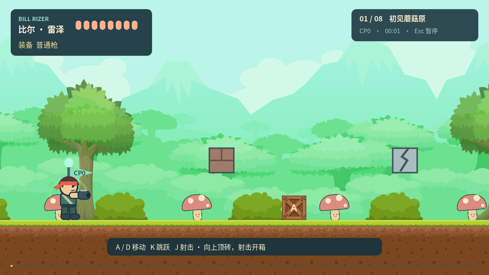
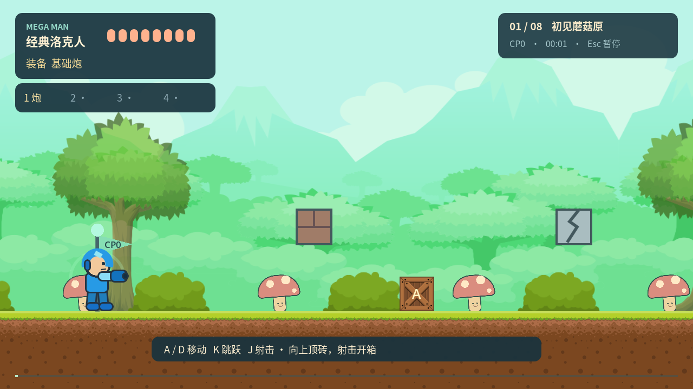
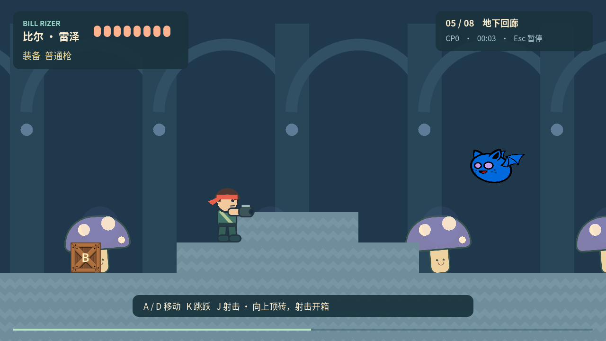
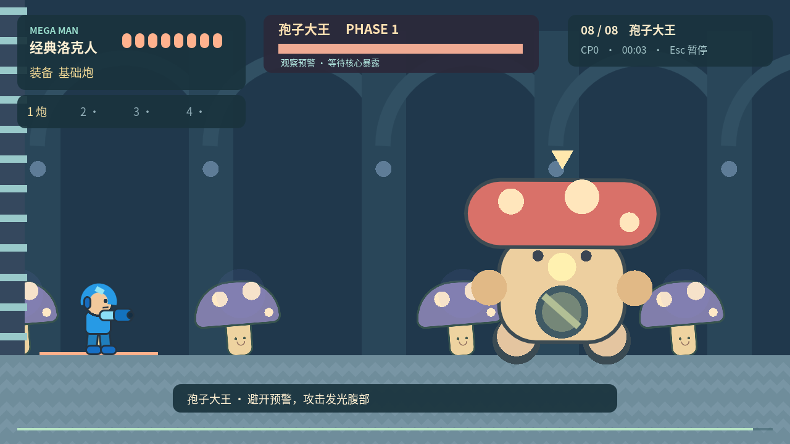

# v0.3 实际验证报告

更新：2026-10-12（开发与验证始于 2026-10-11）。测试环境为本机 Windows、Godot `4.7.2.stable.steam.ed1daf0bf`、Compatibility / 60 Hz 物理。真实窗口日志识别到 NVIDIA GeForce RTX 4060、OpenGL 3.3、驱动 560.94。未把此硬件信息当作帧率达标证明。

## 已执行检查

| 检查 | 实际结果 | 证据 |
| --- | --- | --- |
| 编辑器资源导入、主场景启动 | 正常退出，无脚本错误 | `implementation_import.log`、`implementation_startup.log` |
| 规则与状态边界 | 55 项通过，0 失败 | `gameplay_results.json`、`gameplay_tests.log` |
| 实际物理、输入及路线可达性 | 23 项通过，0 失败 | `physics_results.json`、`physics_tests.log` |
| 双角色整关自动输入 | 两者均击败 Boss、完成 E1/E2、抵达 CP5 | `full_run_results.json`、`full_run.log` |
| 双角色基础武器 Boss | 两者均击败 Boss，未改血量/伤害 | `boss_combat_results.json`、`boss_combat.log` |
| 中文注释、命名、换行、关键节点 | 35 份 GDScript、751 个声明、137 个关键节点，无缺项 | `code_audit.json` |
| 运行时代码风格 | gdtoolkit 检查通过 | `code_style.log` |
| 实际窗口画面 | 菜单、角色选择、双角色、地下城、Boss、暂停已渲染并截图检查 | 下方 PNG、`visual_check.log` |
| Windows Release 导出 | 导出 exe 与外置 PCK | `windows_export.log` |
| 独立 exe 启动与 PCK 资源冒烟 | 发行 exe 独立启动；另用引擎加载发行 PCK，验证两角色、40 怪和菜单生命周期 | `release_validation.json`、`export_smoke.log` |

标准 Godot 4.7 导出模板限制外部 `--script`，因此 PCK 资源专项由编辑器引擎从发行目录加载同一 PCK 执行；独立 exe 另做启动检查，两种证据分开记录。参见 [官方命令行支持范围](https://docs.godotengine.org/en/latest/tutorials/editor/command_line_tutorial.html)。

每项最近一次引擎退出码和错误/警告扫描保存在 `implementation_validation.json`。JSON 和完整日志保留失败细节，不以“退出码为零”忽略引擎警告。源码自动化检查的依据是实际引擎运行，而非只检查文件存在。

## 战斗与时间记录的范围

| 自动输入角色 | 主线内容用时 | 挑战总用时 | 死亡 | 结果 |
| --- | --- | --- | --- | --- |
| 比尔 | 191.50 秒 | 200.30 秒 | 0 | 胜利，E1/E2 完成 |
| 洛克人 | 249.78 秒 | 287.77 秒 | 1 | 胜利，E1/E2 完成 |

整关测试从新会话开始，使用实际移动、跳跃和射击输入，允许按游戏规则拾取道具、切换特殊武器和从检查点重试；没有跳过机关、直接杀怪或修改角色血量。测试控制器知道固定坑位和敌人公开状态，因此不是新玩家体验，也不证明普通玩家能无伤。其结果显示熟练路线目前较短，正式的 **14–18 分钟目标仍待六名首次玩家测量与内容校准**。

基础武器 Boss 测试单独从门前场景开始：比尔约 66.20 秒、洛克人约 89.17 秒，均剩余 8 HP；只证明当前三种攻击与核心窗口存在可执行的基础武器胜利路径。没有把这个局部测试称为“基础武器全关通关”。

物理路线测试为隔离地形而停用怪物 AI、移除机关门和破坏物；它证明两角色可通过地形，不能替代上面的完整战斗测试。规则测试会直接构造边界条件；正式游戏不包含这些测试入口。

## QA 覆盖与仍需补测的边界

“部分覆盖”表示存在自动化或实际运行证据，但还没有执行 QA 清单中所有排列组合。

| QA | 本轮证据 / 状态 | 仍需补充 |
| --- | --- | --- |
| F01 | 两角色整关、左右抵消、跳高、松跳、趴下、坑和地形通过 | 离地宽限/缓冲边界的逐帧专测、真人手感 |
| F02–F04 | 权限、原子碎裂、满血保留、角色武器映射有测试 | 所有方向和满能量/落坑回复组合、门前拾取节奏 |
| F05–F08 | 散弹数、上限、能量、真实中/大蓄力、薄墙等覆盖 | 全武器所有角度、切刃返程/火环遮挡等完整矩阵 |
| F09–F13 | 同帧伤害、无敌、五怪冻结、盾壳方向与整关战斗覆盖 | 每种攻击的完整距离/时序边界、已发弹保留的真人观察 |
| F14 | 水平平台实际搭乘、暂停和整关通过 | 四组平台全部头顶/侧面阻挡组合 |
| F15–F18 | 两组开关、两场遭遇战、快照恢复、计时回滚覆盖 | 所有 CP 同帧致死/回拿/反复进入的穷举 |
| F19–F20 | 两角色基础 Boss、半血切换、双方同帧死亡胜利覆盖 | 真人避让体验、三次连续重试等专项 |
| F21–F22 | 实际暂停页、平台暂停、恢复/返回菜单、双角色重新开始 | 全部冷却与冻结的暂停组合、损坏文件专项 |
| F23 | 本机 1280×720 截图、中文 UI 和 Boss 锁镜检查 | 1920×1080、非 16:9、全屏切换完整验收 |
| F24 | 1200 速度弹体对 2 单位薄墙实际回归 | 5 怪 + 80 弹高负载帧率专项，不能宣称已达 60 FPS |
| F25 | 独立导出包在本机无需编辑器进程即可加载两角色 | 第二台干净 Windows 离线通关；最终美术仍待精修 |
| F26 | 官方惯例已落地；中文注释和关键节点机械检查通过 | 注释语义、后续改动持续人工审查 |

## 画面证据

以下是引擎 Viewport 原始截图。为检查特定区段，截图脚本会直接定位地下城与 Boss 房；它们只用于画面验证，不作为通关证据，截图中的 CP/计时也不代表正常路线进度。

## 已修复的验证发现

- 遭遇战中央站位候选点不足：增加安全候选点并在实际生成前再次检查距离。
- 贴墙枪口可能跨过薄实体：增加肩部到枪口遮挡检测，并对弹体使用扫掠及沿途实体检查。
- 暂停中松开 J 可能遗留蓄力：原始释放事件立即取消旧蓄力，恢复时通过输入门禁防止确认键穿透。
- Boss 入场可能短暂沿用移动镜头：进入锁镜区时重置相机平滑。
- 退出时偶发音频解码资源未释放：关闭前主动停止轨道、清理音效，再给音频线程回收时间。
- 自动输入控制器的坑前起跳与锁门场射击节奏导致测试卡住：修正测试策略后两角色整关通过，没有降低正式怪物属性来迁就脚本。

## 复现

在项目根目录执行 `python tools/validate_project.py`，默认检查导入、规则、物理和启动。使用 `--only boss`、`--only full`、`--only visual`、`--only export` 运行专项。`python tools/package_release.py` 验证已有导出包并生成附带许可的 ZIP；`python tools/audit_code.py` 检查源码注释与节点说明。

本机引擎位于 `.tools/godot/godot.exe`；换机可设置 `GODOT_BIN`。Windows 导出需要与引擎匹配的模板。Headless 模式不实际播放音频；有窗口运行和主观试听是不同证据，试听结论仍为待验收。
